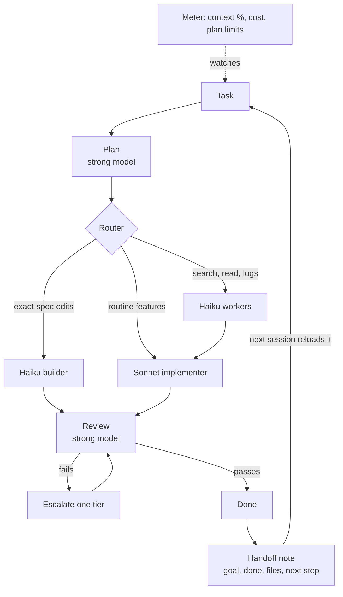

# claude-usage-kit

How I run Claude Code on a $20 Pro plan for real production work: a set of
private plugins and skills that route every step to the cheapest model that
can do it, keep sessions small, and show cost and limits live.

This repo is the overview. The plugins themselves are private; happy to
demo them.

Built by Doan Idriz, Python full-stack and AI automation engineer
(Plovdiv, Bulgaria). Agents and RAG pipelines in pure Python, no
LangChain or CrewAI.

## The idea

Most Claude usage is input, not output: chat history, file reads, tool
results and connector definitions are resent on every turn. Shorter replies
help a little. Reading less, on a cheaper model, helps a lot.

So the system attacks three things:

1. **Which model reads and writes.** Strong models decide, cheap models type.
2. **How big a session gets.** Small sessions with a handoff beat one long one.
3. **What you can see.** Cost and limits on screen, before you hit them.

## Architecture

## The pieces

| Piece | What it does |
|---|---|
| **fresh** | Fully automatic, no slash commands. Haiku does searching, reading and routine text, Sonnet does routine features, the main model only plans and reviews. Keeps a handoff note and reloads it in the next session, so starting fresh costs almost nothing. |
| **orchestrator** | Plan strong, build cheap, review strong, escalate only on failure. Rules caught twice in review get promoted into the agents' own instructions. |
| **meter** | Context %, session cost and 5h/weekly plan limits above the prompt, with warnings before a limit. Uses no model tokens. |
| **vault** | Shared snippet library across projects. Claude searches it before writing code and saves reusable pieces after. |
| **toolbox** | A catalog of every tool I reviewed (license, free-tier limits, install line), free-first defaults. |
| **account skills** | Always-on terse reply style, free-first tool choice, design consistency via DESIGN.md. |

## Rules it runs on

- Strong models for decisions, cheap ones for typing.
- Read narrow before wide; big outputs go to a file, read back only what matters.
- Never paste the same code or log twice; refer to it.
- Turn off connectors you are not using; each one costs tokens every turn.
- Verify by running, not by reading. Anything unverified is reported as unverified.

## Free sample

[`skills/usage-saver`](skills/usage-saver/SKILL.md) is the general-purpose
skill from the set. Drop it into your Claude account or `~/.claude/skills/`.

## Contact

doanchetoidriz@gmail.com
